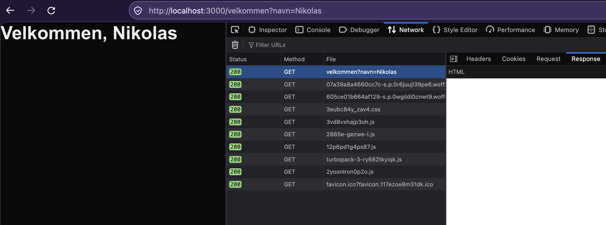
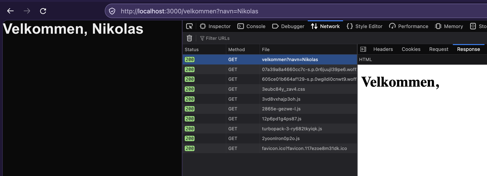

<!-- _class: title -->

<header>
  
  
  <time>10.11.2026</time>
</header>

# Cache components

Nikolas Rølland Hugsted

---

# Kjapp intro til Next.js

* React-rammeverk
  - Server-side rendering
  - API-endepunkt
* Magisk optimalisering
* Mappe-konvensjon

---

<style scoped>
section {
    font-size: 16px;
}
</style>

```
my-nextjs-app/
├── next.config.ts
│
├── public/
│   └── favicon.ico
└── src/
    └── app/
        ├── layout.ts
        ├── page.ts
        ├── loading.ts
        ├── error.ts
        │
        └── products/
            ├── layout.ts
            ├── page.ts
            └── loading.ts
```

<!-- Egen api-mappe, path parmeters i brackets -->


---

# Kjapp intro til Cache Components

* "use cache" directives
* Komponenter er funksjoner
* Litt sånn som AOP

---

<!-- _class: code -->

```java
@Cacheable("data")
public Book getData() {
    // ...
}
```

<!-- Spring-eksempel -->

---

<!-- _class: code -->

```c#
[CacheResult(DurationInMinutes = 10)]
public async Task<Data> GetDataAsync()
{
  // ...
}
```

<!-- C#-eksempel  -->

---

<!-- _class: code -->

```ts
async function getData(): Data {
  "use cache";
  cacheLife("minutes"); 
  // ...
}
```

---

# The story so far

* Enten dynamisk eller statisk
* Implisitt caching 🐉
* Mange experimental flags
* Introdusert i Next 16
* Standardvalg for create-next-app i Next 16.4

---

<!-- _class: divider left -->

The least interesting thing about cache components is cache components.

<div data-marpit-fragment>
– Meg
<div>

---

<!-- _class: code -->

```ts
const nextConfig: NextConfig = {
  cacheComponents: true,
  // ...
};
```

<!-- For hva er egentlig cache components løsningen på? -->
<!-- Og hva annet er det du får på kjøpet når du skrur det på? -->

---

# Hvor vi skal ende opp

- SSG
- PPR
- ISR

<!-- Det følger med en haug med bokstavkjeks -->
<!-- Med vilje utelatt – kommer tilbake til det -->

---

# Hvor vi skal ende opp

- Cache directives og handlers
  - "use cache: remote"
  - "use cache: private"
- `cacheTag()` og `cacheLife()`
- `revalidateTag()` og `updateTag()`

<!-- Hvis vi får tid se på Cache Components -->

---

# Min egen reise

* Seint på Next-toget
* Cache Components fra starten
* Mye dynamisk innhold
  - Ikke like stor gevinst
  - Må fortsatt forholde seg til reglene
* Høy WTFs/min

---

# Min egen reise

1. Fornektelse
2. Sinne
3. Forhandling
4. Depresjon
5. Aksept
6) Talk

<!-- Vært igjennom alle stegene -->
<!-- Omsider står jeg her -->
<!-- Spare dere for å lese dokumentasjonen -->

---

# Steg tilbake

- Cache components kommer med regler
- "Men hvorfor kan jeg ikke bare...?!"
- På med Next-hatten 🤠

---

# Steg tilbake

- Vi skal lage det neste rammeverk oppe på React
* Raskt som fy 🚀
  - Returner det som er klart
  - First Contentful Paint 🥇
* Komme fram til de samme reglene
* Mer intuitivt og mindre frustrerende

---

# Det som aldri endres

```tsx
export default function Page() {
  return <h1>Velkommen til hjemmesiden min! 🔥</h1>;
}
```

---

# Det som aldri endres

- Statisk innhold
- Trengs kun å rendres én gang
- Lagrer HTML-resultatet

---

<!-- _class: divider -->

### Visjonen vår: "Raskt som fy 🚀"

<!-- Vi skal aldri ha en treg (første) render -->

---

<!-- _class: divider -->

### Dette må skje før deploy – på build

---

<!-- _class: divider -->

### Alt burde jo være statisk innhold

<!-- For at det skal bli riktig må vi få generert samme innhold hver gang -->

---

# Ban list

- `Date.now()` ❌
- `Math.random()` ❌
- `fetch(...)` ❌
- Headers og cookies ❌
- URL og query parameters ❌
- Miljøvariabler ❌

---

<!-- _class: divider -->

### Ting går bra for det neste React-rammeverket

---

<!-- _class: divider -->

###  Sliter litt med å få flere brukere

---

# Letter litt på kravene

- Miljøvariabler
- `Date.now()`
- `Math.random()`
*  ⚠️ Men låses inn på build ⚠️

---

# Letter litt på kravene

- Mulig å opte ut for dynamisk innhold
  * Manuelt eller magi 🧙
  * Render time 📈
  * First Contentful Paint 📈
* Dårlig stemning i teamet

<!-- Kamelene og de sure eplene står i kø. -->
<!-- Gjør det mulig å bruke URL og query parameters, headers og cookies. -->
<!-- Dårlig stemning – lite elegant og langt fra visjonen -->

---

# What's the problem?

- A monad is just a monoid in the category of endofunctors

---

# Hva er problemet?

- Forskjellige typer innhold
  * Aldri endres
  * Alltid endres
  * Sjeldent endres
* Kan kombineres per side

<!--
  - Ny verdi hver gang
  - Kan sende inn verdi
-->
---

<!-- _class: center -->


<!-- Det blåe er det som endres -->
<!-- Header, brukermeny, varselsbanner, nyhetsstrøm, sidemeny, footer -->

---

# Pre-render person POV

* Det som er statisk og det som ikke er statisk
* Det som er klart på forhånd og det som ikke er klart på forhånd
* Det som er der og det som ikke er der

<!-- Mens teamet diskuterer sitter personen som skriver pre-render-koden og filosoferer -->
<!-- Hadde jeg bare hatt... -->

---

<!-- _class: divider -->

### En placeholder for det som ikke er der

<!-- Et sånn løfte. Og med det kommer åpenbaringen... -->

---

<!-- _class: divider -->
# Promise

---

# A promise is all you need

- Redefinerer betydningen av et promise
  * En verdi som blir tilgjengelig senere
  * En verdi som ikke kan være med i den statiske genererte siden
* Alt som er dynamisk returneres som Promise
  * "Skallet" til siden lastes først
  * Nytt async API for URL og query params, cookies og header
  * React Server Components med async/await

<!-- Ikke fordi vi trenger async params osv. -->

---

<style scoped>
section {
    font-size: 16px;
}
</style>

```tsx
function MyApp() {
  return (
    <header>
      <Menu />
      <UserMenu />
    </header>
    <main>
      <SystemMessage />
      <News />
      <SidePanel />
    </main>
    <footer>
      <Links />
    </footer>
  );
}
```


---

<style scoped>
section {
    font-size: 20px;
}
</style>


```
html
  head
    ...
  body
    header
      Menu
      UserMenu
    main
      SystemMessage
      News
      SidePanel
    footer
      Links
```

---

<style scoped>
section {
    font-size: 20px;
}
</style>


```
html
  head
    ...
  body
    header
      Menu
      Promise<UserMenu>
    main
      Promise<SystemMessage>
      Promise<News>
      SidePanel
    footer
      Links
```

---

Hva har vi oppnådd?

* Det som rendrer ser unresolved promises
* Alt "før" et promise i treet kan rendres på forhånd
* Siden kan blande statisk og dynamisk innhold
* For øyeblikket er det tomt

---

<style scoped>
section {
    font-size: 16px;
}
</style>

```tsx
function MyApp() {
  return (
    <header>
      <Menu />
      <UserMenu />
    </header>
    <main>
      <SystemMessage />
      <News />
      <SidePanel />
    </main>
    <footer>
      <Links />
    </footer>
  );
}
```

---

<style scoped>
section {
    font-size: 16px;
}
</style>

```tsx
function MyApp() {
  return (
    <header>
      <Menu />
      <Suspense fallback={Spinner}><UserMenu /></Suspense>
    </header>
    <main>
      <Suspense fallback={null}><SystemMessage /></Suspense>
      <Suspense fallback={NewsSkeleton}><News /></Suspense>
      <SidePanel />
    </main>
    <footer>
      <Links />
    </footer>
  );
}
```

---

<!-- _class: divider -->

# Nice

---

# Recap

- Løst problemet med "øyer" av dynamisk innhold
* Så mye som mulig av siden kan rendres på forhånd
* Placeholders via Suspense
* Problematiske funksjoner er async


---

<!-- _class: code -->

- Forskjellige typer innhold
  - Aldri endres <span data-marpit-fragment>✅</span>
  - Alltid endres <span data-marpit-fragment>✅</span>
  - Sjeldent endres <span data-marpit-fragment>❎</span>

---

# Det som sjeldent endres

* Vi rendrer så mye som mulig på forhånd
* Ta med det som endres sjeldent?
  * Vi må bare huske å oppdatere det av og til
  * API for å
    - si hvor ofte 
    - oppdatere manuelt

---

<!-- _class: divider -->

# Det som sjeldent endres?

---

<!-- _class: divider -->

# ...mener du caching?

<!--
Og med det tenker jeg at vi forlater vårt fiktive team og tar en 5 minutters pause.
Etterpå prøver vi å koble denne historien opp mot SSG, PPR, ISR og Cache Components.
-->

---

# Hvor vi skal ende opp

- SSG: Static Site Generation
- PPR: Partial pre-rendering
- ISR: Incremental Static Regeneration

---

# Static Site Generation

```tsx
export default function Page() {
  return <h1>Velkommen til hjemmesiden min! 🔥</h1>;
}
```

---

# Static Site Generation

- Null dynamiske hull
- my-app/.next/server/app/
  - velkommen.html
  * velkommen.meta
  * velkommen.rsc

<!-- next build -->

---

# Static Site Generation

- Inkluderer også cached data på build
* Miljøvariabler kan bli låst inn
* Frustrasjon
  - Gjør jeg noe feil?
  - Det gir ikke mening å hente på build 

---

<style scoped>
section {
    font-size: 24px;
}
</style>

```tsx
export default async function Page() {
  const name = await getName();
  return <h1>Velkommen, {name}!</h1>;
}

async function getName() {
  "use cache";
  await new Promise((resolve) => setTimeout(resolve, 1000));
  return "Nikolas";
}
```

---

<style scoped>
section {
    font-size: 24px;
}
</style>

```
$ next build
▲ Next.js 16.4.3 (Turbopack)
✓ Running next.config.ts took 71ms
- Cache Components enabled
- Partial Prefetching enabled

Route (app)                           Revalidate  Expire
┌ ○ /
├ ○ /velkommen
└ ○ /velkommen-navn                           15m      1y

○  (Static)             prerendered as static content
```

---

# Partial pre-rendering

- Rendre så mye som mulig
* await
  - uncached I/O
  - data fra request
* Opp til første Suspense
  * loading.tsx
  * `<Suspense fallback="..."><DynamicThing /></Suspense>`


<!-- Det er ikke Suspense som stopper skallet -->

---

<style scoped>
section {
    font-size: 24px;
}
</style>


```tsx
type PageProps = {
  searchParams: Promise<{ navn: string }>;
};

export default async function Page({ searchParams }: PageProps) {
  const { navn } = await searchParams;
  return <h1>Velkommen, {navn}!</h1>;
}
```

---

<style scoped>
section {
    font-size: 14px;
}
</style>

```
Error: Route "/velkommen": Next.js encountered uncached or runtime data during prerendering.

`fetch(...)`, `cookies()`, `headers()`, `params`, `searchParams`, or `connection()` accessed outside of `<Suspense>` prevents
the route from being prerendered, blocking the page load and leading to a slower user experience.

Ways to fix this:
  - [stream] Provide a placeholder with `<Suspense fallback={...}>` around the data access
  - [cache] For uncached data (`fetch`, database calls): cache the access with `"use cache"` (does not apply to `connection()`)
  - [block] Set `export const instant = false` to allow a blocking route
```

<!--
Åpenbart er verdien der runtime. Next har mottatt requesten og sendt den til velkommen route.
Men den er der ikke build time.
Og vi bruker Promises* for å avgjøre om det er der build time eller ikke.
-->

---

# Partial pre-rendering

- Unresolved promise blokkerer
* Vi er på toppnivå av en page – to måter å fikse på
  - `<Suspense>{children}</Suspense>` i layout.tsx
  - loading.tsx

---

<style scoped>
section {
    font-size: 20px;
}
</style>

```
Route (app)                           Revalidate  Expire
┌ ○ /
├ ◐ /velkommen
└ ○ /velkommen-navn                          15m      1y


○  (Static)             prerendered as static content
◐  (Partial Prerender)  prerendered as static HTML with dynamic server-streamed content
```

---

# Partial pre-rendering

- Hva er HTML-skallet?
* Avhenger av hvor
  - man resolver promiset
  - nærmeste suspense boundary er
* Med en gang i page.tsx: `await searchParams`
* Skallet blir layout.tsx: `<Suspense>{children}</Suspense>`

---

<style scoped>
section {
    font-size: 20px;
}
</style>

```tsx
export default async function Page({ searchParams }: PageProps) {
  return (
    <h1>
      Velkommen, <Navn searchParams={searchParams} />
    </h1>
  );
}

async function Navn({ searchParams }: PageProps) {
  const { navn } = await searchParams;
  return navn;
}
```

---

<style scoped>
section {
    font-size: 20px;
}
</style>

```tsx
export default async function Page({ searchParams }: PageProps) {
  return (
    <h1>
      Velkommen, <Suspense><Navn searchParams={searchParams} /></Suspense>
    </h1>
  );
}

async function Navn({ searchParams }: PageProps) {
  const { navn } = await searchParams;
  return navn;
}
```

---

<style scoped>
section {
    font-size: 20px;
}
</style>

```tsx
export default async function Page({ searchParams }: PageProps) {
  return (
    <h1>
      Velkommen, <Suspense><Navn searchParams={searchParams} /></Suspense> 
    </h1>
  );
}

async function Navn({ searchParams }: PageProps) {
  const { navn } = await searchParams;
  return navn;
}
```

---

<!-- _class: center -->



---

<!-- _class: center -->



---


<!-- _class: center -->


<!--
Superenkelt eksempel.
Kan bare hente ut searchParams i page.tsx.
Som regel har man haugevis med nøsta komponenter.
await på toppen gjør alt dynamisk.
-->

---

# Ban list

- `Date.now()` ❌
- `Math.random()` ❌
- `fetch(...)` ❌
- Headers og cookies ❌
- URL og query parameters ❌
- Miljøvariabler ❌

---

# Ban list

- `Date.now()` ✅ (cache eller dynamisk)
- `Math.random()` ✅ (cache eller dynamisk)
- `fetch(...)` ✅ (cache eller dynamisk)
- Headers og cookies ✅ (dynamisk)
- URL og query parameters ✅ (dynamisk)
- Miljøvariabler 🐉

---

# Tips

* Send unresolved promises som props
* Suspense så nærme await som mulig
* Inspiser HTML-response
* Se på build output
  ```
  ○	Static
  ◐	Partial Prerender
  ƒ	Dynamic
  ```


---

# Tips (dårlige)

* `await connection()`
* `export const instant = false`
* Ingen suspense gir full HTML-response

---

<!-- _class: divider -->

# Cache Components

---

<!-- _class: divider -->

# Incremental Static Regeneration

---

# Incremental Static Regeneration

```
Route (app)                           Revalidate  Expire
┌ ○ /
├ ◐ /velkommen
└ ○ /velkommen-navn                          15m      1y
```

---

# Incremental Static Regeneration

- Løsningen på "Det som sjeldent endres"
- Oppdaterer skallet periodisk
- Fantes fra før
- Nå består skallet av flere ting
  - Du ber om caching per ting
  - Kan ha forskjellig utløpstidpunkt

---

<!-- _class: center -->

# Og

---

<!-- _class: center -->

# da

---

<!-- _class: center -->

# kjære

---

<!-- _class: center -->

# publikum

---

<!-- _class: center -->

# Cache Components

<!-- Pause? -->

---

<!-- _class: code -->

```ts
async function getData(): Data {
  "use cache";
  cacheLife("minutes"); 
  // ...
}
```

---

<!-- _class: code -->

```ts
async function getData(): Data {
  "use cache";
  cacheLife("minutes");
  cacheTag("min-data");
  // ...
}
```

---

<!-- _class: code -->

<style scoped>
section {
    font-size: 16px;
}
</style>

```ts
async function getData(): Data {
  "use cache";
  try {
    const response = await fetch(...);

    if (response.ok) {
      const data = await response.json();
      cacheTag(data.id); // Kan kalles med flere args
      cacheLife("hours");
    } else {
      cacheLife("minutes");
    }
  } catch {
    cacheLife("minutes");
  }
}
```

---

# cacheLife

<style scoped>
section {
    font-size: 16px;
}
</style>

<table><thead><tr><th><strong>Profile</strong></th><th><strong>Use Case</strong></th><th><code>stale</code></th><th><code>revalidate</code></th><th><code>expire</code></th></tr></thead><tbody><tr><td><code>default</code></td><td>Standard content</td><td>5 minutes</td><td>15 minutes</td><td>never</td></tr><tr><td><code>seconds</code></td><td>Real-time data</td><td>30 seconds</td><td>1 second</td><td>1 minute</td></tr><tr><td><code>minutes</code></td><td>Frequently updated content</td><td>5 minutes</td><td>1 minute</td><td>1 hour</td></tr><tr><td><code>hours</code></td><td>Content updated multiple times per day</td><td>5 minutes</td><td>1 hour</td><td>1 day</td></tr><tr><td><code>days</code></td><td>Content updated daily</td><td>5 minutes</td><td>1 day</td><td>1 week</td></tr><tr><td><code>weeks</code></td><td>Content updated weekly</td><td>5 minutes</td><td>1 week</td><td>30 days</td></tr><tr><td><code>max</code></td><td>Stable content that rarely changes</td><td>5 minutes</td><td>30 days</td><td>1 year</td></tr></tbody></table>

<!-- Fun fact om seconds. Kan også overskrive i next.config.ts -->

---

# cacheLife

- stale: Klient spør server på nytt
- revalidate: Server lager ny i bakgrunn
- expire: Borte!
* minutes
  - stale: 5 min
  - revalidate: 1 min
  - expire: 1 time

---

# cacheTag

- revalidateTag(): Ny data lastes senere
- updateTag(): Ny data lastes med en gang

```tsx
async function updateData() {
  // update data
  revalidateTag("min-data");
}
```

<!-- Lar deg manuelt oppdatere -->

---

# revalidatePath

- Ikke stol på noen cache når du rendrer denne siden
- Kan føre til at annen cache blir oppdatert

---

# Recap

- Cache Components sitt API <span data-marpit-fragment>(for å spille på lag med SSG og ISR)</span>
  - cacheLife
  - cacheTag
  - updateTag
  - revalidateTag
  - revalidatePath

---

# Men hvordan caches det?

- cacheHandler (ISR)
- cacheHandlers
- Får bare in-memory
  - "use cache"
  - "use cache: private"
- Kan spesifisere flere cacheHandlers
  - "use cache: remote"

---

<!-- _class: divider -->

# «E cache components nais?»

<!-- Vet ikke helt hva jeg skal svare -->

---


---

<!-- _class: center -->


<!--
SSG
ISR
PPR
CSR
SSR
-->

---


Feedback

QR
1-5 Hvor nyttig var del 1
1-5 Overall
Tilbakemelding

---

Er 

Er Next nice?
Fordi hvis du ikke vil ha cache components bør du bytte rammeverk.
Cache Components som muliggjør ISR?

Partial pre-rendering er fett
Mest sannsynlig jeg og det jeg jobber på overlevd uten

Cache API og Next-magi
- Kult
- With great powers... (se for deg spaghetti-cachinga)
- Lock-in osv.

Cache handlers:
- Noe uforløst over over in-memory
- Skulle gjerne hatt remote impl. som first class citizen
- Private er kult I guess

---

<!-- - `cookies()`
- `headers()`
- `params`
- `searchParams` -->

`cookies()`, `headers()`, `params`, or `searchParams` accessed outside of `<Suspense>` prevents the route from being prerendered, blocking the page load and leading to a slower user experience.

---

- `.next/server/app/velkommen.html`

Må gi et eksempel på dynamic verdi **placeholder**

---

Se på output hva hver page blir

---

# Cache directives

- "use cache"
- "use cache: remote"
- "use cache: private"

Self hosted?

- nextjs.org/docs/app/getting-started/caching
- nextjs.org/docs/app/api-reference/directives/use-cache-remote
- nextjs.org/docs/app/api-reference/config/next-config-js/cacheHandlers
- github.com/vercel/next.js/tree/canary/examples/cache-handler-redis
- github.com/mrjasonroy/cache-components-cache-handler

---

Nice – nå er masse cached
Problem – nå er masse cached

Hvordan invalidere osv.

---

"use cache"-funksjoner må være async

---
